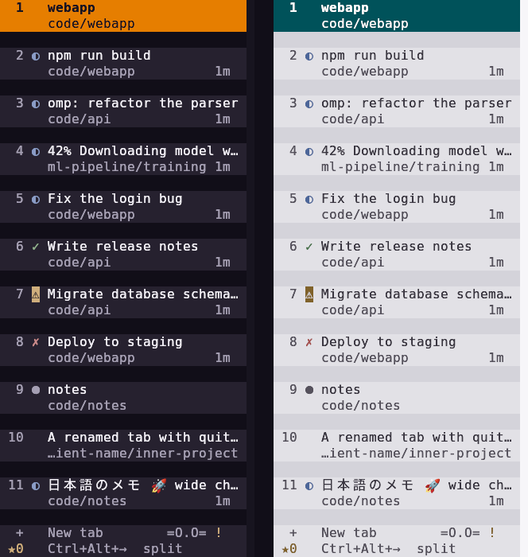

# NineLives

A [kitty](https://sw.kovidgoyal.net/kitty/) terminal setup for watching many AI coding sessions at
once. Every session is a tab in a left sidebar with a live status icon; a quiet sound and a small cat
tell you when a tab finishes or needs you; tabs drag to reorder; and one script restarts kitty and
brings every tab back. Nine lives, one cat.



Spinning ◐ = working · ✓ = finished · amber block ⚠ = **needs you** · ✗ = error · ● = new output ·
`1m` = how long · `=O.O= !` = the cat saying a tab needs you · `★0` = your next quest.

## Requirements
- **Linux** with **kitty 0.50 or newer**, the [official build](https://sw.kovidgoyal.net/kitty/binary/)
  (tested on 0.51; distribution packages are often older, e.g. Ubuntu's 0.32 has no sidebar).
- **Python 3** (for the restart script and the tab search).
- Optional: `paplay` (PipeWire or PulseAudio) for the sounds. Without it everything else works, silently.
- Built on Pop!_OS COSMIC (Wayland) and works best there; it also runs on other desktops, X11 or Wayland.
  Light and dark follow your desktop's light/dark setting where the desktop reports one through the
  desktop portal (COSMIC does); elsewhere you get the dark theme ([how to change it](docs/wiki/Installing.md#light-and-dark)).
- Only for development: `Xvfb` and `ffmpeg` (the hidden test kitty and the sound checks).

## Install
```bash
git clone https://github.com/Vyeche/NineLives.git && cd NineLives
bash scripts/install.sh --dry-run   # see what would change; touches nothing
bash scripts/install.sh             # copy config/ into ~/.config/kitty (backs up what it replaces)
```
Then **close kitty and open it again once**: the sidebar's patches and the remote-control socket the
restart script uses only load when kitty starts. Press **F1** in kitty for every shortcut, and run
`kitty-sounds` to hear what each sound means.

The tip under each prompt and the `kitty-*` commands need one line in `~/.bashrc`:
```bash
if [[ $- == *i* && "$TERM" == xterm-kitty && -r ~/.config/kitty/tips.sh ]]; then . ~/.config/kitty/tips.sh; fi
```

## Restart kitty without losing tabs
```bash
bash scripts/kitty-relaunch.sh --when-idle   # wait until no tab is busy, then restart and reopen every tab
```
Run it from a tab of the kitty you want to restart. Each tab comes back in its folder, splits and
names included; Claude Code resumes its session. Use it after updating (`git pull`, then
`bash scripts/install.sh`). More in [Installing](docs/wiki/Installing.md#restart-kitty-and-keep-every-tab).

## Uninstall
```bash
bash scripts/uninstall.sh --dry-run   # see what would change
bash scripts/uninstall.sh             # remove NineLives' files, put your old kitty.conf back
```
It only removes files that are NineLives versions (a file you changed is kept), and puts back the
backup `install.sh` made of your own config. Then restart kitty and, if you like, delete the
`tips.sh` line from `~/.bashrc`.

## At a glance
| | |
| --- | --- |
| **Status** | ◐ working (blue) · `· ✧ ✦ ✶` → ✓ finished (green) · **amber block ⚠ needs you** · ✗ error (red) · ● new output. The folder line shows how long (`3m`). [More](docs/wiki/The-Sidebar.md) |
| **Sounds** | quiet and short: two notes up = done, a rising "mrrp?" = needs you, two low notes down = error, plus badge and rank sounds. Silent for the tab you're watching. **Ctrl+Alt+M** mutes, `kitty-sounds volume 40` turns down. [More](docs/wiki/Sounds.md) |
| **The cat** | at the end of **+ New tab**, it sums up every tab: `=O.O= !` needs you, `=^.^= ~` working, `=^ω^= ♪` done, `=-.-= zZ` napping. [More](docs/wiki/The-Cat.md) |
| **Quests** | 16 shortcuts worth knowing; use one once to earn its badge, from Kitten to Nine Lives. `kitty-quests` lists them. [More](docs/wiki/Quests-and-Badges.md) |
| **Tabs** | click, **Alt+1…9**, drag to reorder, middle-click closes, **Ctrl+Shift+T** new tab here, **Ctrl+Shift+Space** search tabs, **Ctrl+Alt+U** the tab waiting for you; a git branch other than main shows after the folder |
| **Splits** | **Ctrl+Alt+→/↓** split, **Ctrl+Alt+arrows** move, **Ctrl+Alt+Z** zoom |
| **Look** | COSMIC colours, light and dark; soft "dusty" terminal colours; DejaVu Sans Mono 12 |

`ninelives` shows every setting at a glance. Everything can be turned off: `kitty-sounds off`, `kitty-cat off`,
`kitty-quests off`, `kitty-tips off`, `kitty-buttons off`
([all switches](docs/wiki/Commands-and-Switches.md)).

## Documentation
The [wiki](https://github.com/Vyeche/NineLives/wiki) (source in [`docs/wiki/`](docs/wiki/Home.md)):

| Page | What |
| --- | --- |
| [What's new](docs/wiki/Whats-New.md) | recent changes |
| [Installing](docs/wiki/Installing.md) | install, update, restart without losing tabs, light and dark |
| [The sidebar](docs/wiki/The-Sidebar.md) | every icon, colour and number |
| [Sounds](docs/wiki/Sounds.md), [The cat](docs/wiki/The-Cat.md), [Quests and badges](docs/wiki/Quests-and-Badges.md) | the fun parts, and how to turn them off |
| [Shortcuts](docs/wiki/Shortcuts.md), [Commands and switches](docs/wiki/Commands-and-Switches.md) | every key, command and setting |
| [Troubleshooting](docs/wiki/Troubleshooting.md) | when something doesn't work |
| [How it works](docs/wiki/How-It-Works.md), [Testing](docs/wiki/Testing.md) | for changing it |

## Contributing
Issues and pull requests are welcome: see [CONTRIBUTING.md](CONTRIBUTING.md) and the
[Code of Conduct](CODE_OF_CONDUCT.md). Security problems: [SECURITY.md](SECURITY.md).

## Authoring
NineLives was written with AI coding assistance, directed and reviewed by a human who decided its
design and scope. NineLives itself contains no AI and makes no network calls at runtime: sounds play
through `paplay`, notifications go over the local D-Bus session bus, and everything else stays in
kitty and your config folder.

NineLives was built with [HOL Guard](https://hol.org/guard) in the loop. Every AI coding session that
worked on it ran through a local harness where HOL Guard gated actions before the assistant took
them: destructive shell commands, secret access, software installs and data movement were allowed,
asked about or blocked, and a record kept of what happened. It guards the development machine, not
the source: nothing it protects lives in this repository, and NineLives ships with none of it. HOL
Guard also scans this repository in the [Gauntlet](CONTRIBUTING.md#the-gauntlet) on every push to
`main`.

## Support
NineLives is free and MIT licensed. If it helps you,
**[:heart: Sponsor on GitHub](https://github.com/sponsors/Vyeche)**. That's genuinely optional: a
star, a real bug report or telling a colleague helps just as much.

## License
[MIT](LICENSE)
