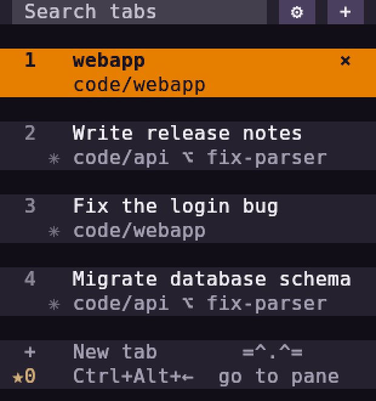
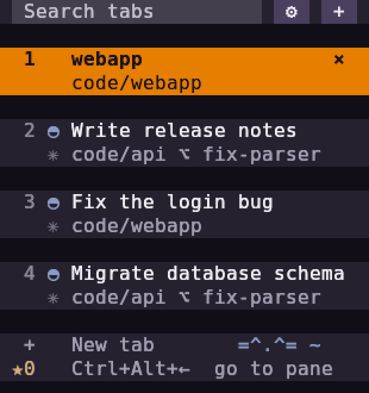
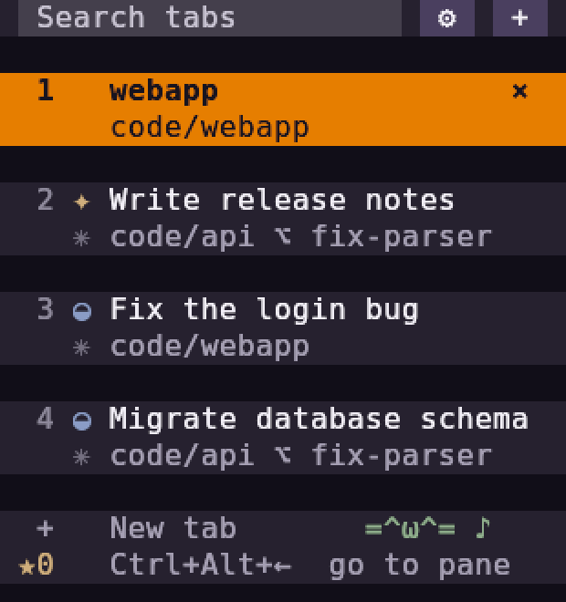
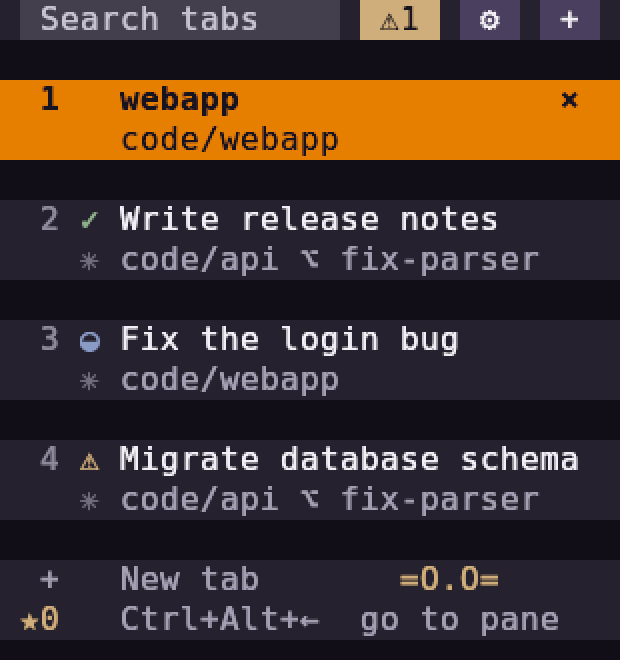
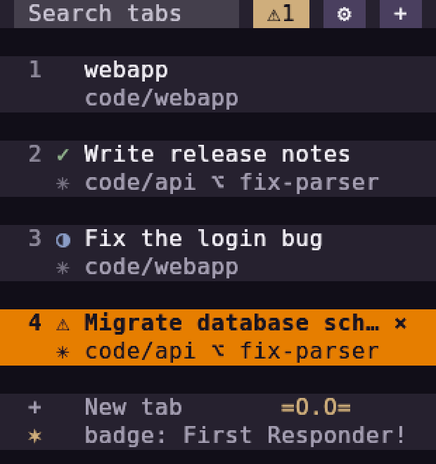
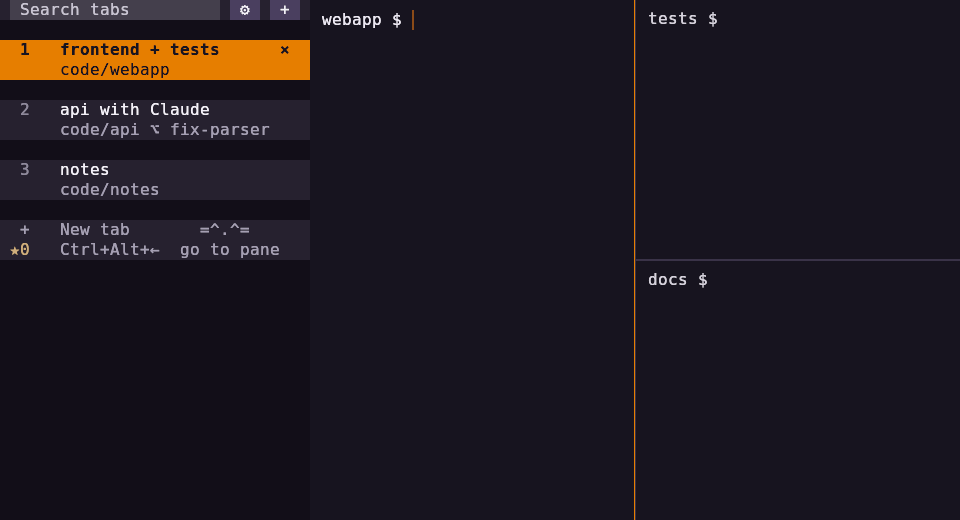
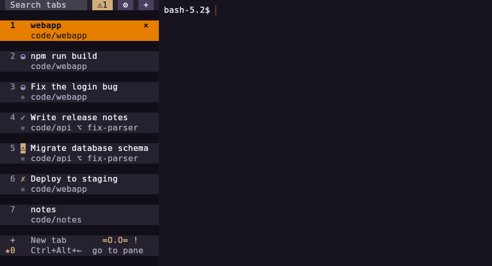
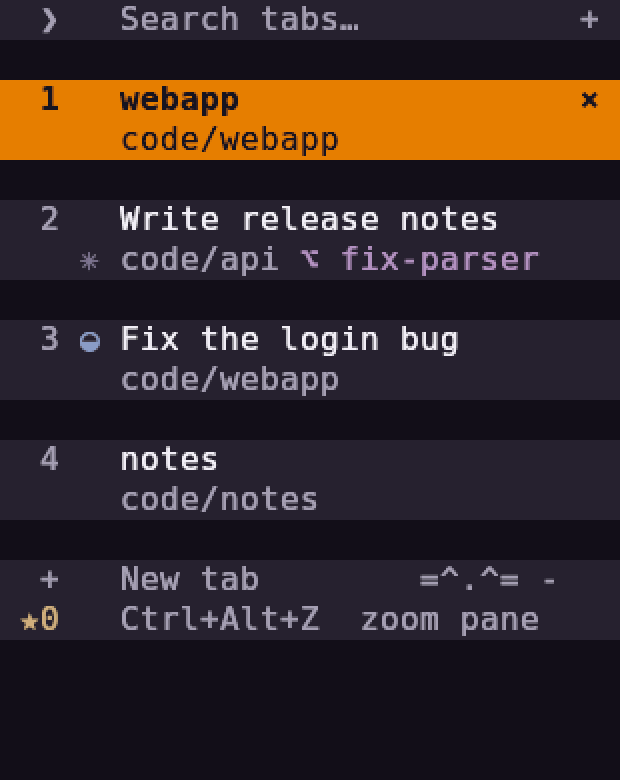
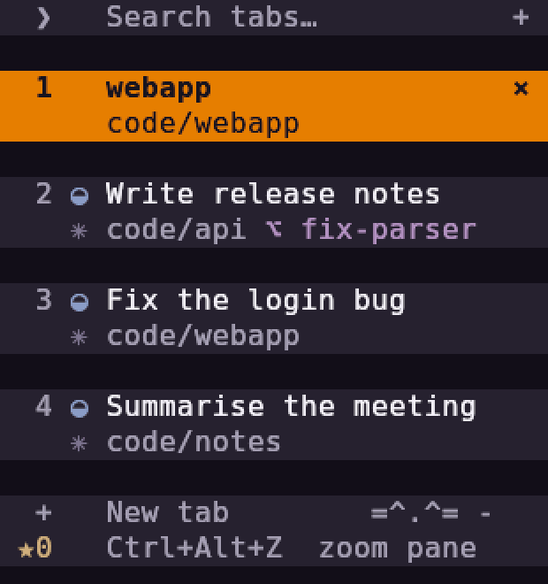

# Getting started

From a fresh install to your first "needs you" in five minutes. Every picture here was recorded
from a hidden test kitty with made-up tabs (`bash scripts/record.sh`, see [Testing](Testing)).


## 1. Install
You need Linux, **kitty 0.50 or newer** (the [official build](https://sw.kovidgoyal.net/kitty/binary/))
and Python 3. `paplay` is optional, for the sounds. On a Mac it is new and untested on real hardware:
read [macOS](Installing#macos) first, and tell us how it went.
```bash
git clone https://github.com/Vyeche/NineLives.git && cd NineLives
bash scripts/install.sh --dry-run   # see what would change; touches nothing
bash scripts/install.sh             # copy config/ into ~/.config/kitty (backs up what it replaces)
```
More options, and how to update later: [Installing](Installing).

## 2. Add the tip line to `~/.bashrc`
The tip under each prompt and the `kitty-*` commands (`kitty-sounds`, `kitty-cat`, `kitty-quests`,
`kitty-tips`, `ninelives`) need one line in `~/.bashrc` (zsh, the Mac's default: in `~/.zshrc`):
```bash
if [[ $- == *i* && "$TERM" == xterm-kitty && -r ~/.config/kitty/tips.sh ]]; then . ~/.config/kitty/tips.sh; fi
```

## 3. Restart kitty once
Close kitty and open it again. The sidebar's patches and the remote-control socket the restart
script uses only load when kitty starts. After this first time, `bash scripts/kitty-relaunch.sh`
restarts kitty for you and brings every tab back ([step 8](#8-restart-without-losing-tabs)).

Press **F1** for every shortcut, and run `kitty-sounds` to hear what each sound means.

## 4. Open a few tabs
**Ctrl+Shift+T** opens a tab in the current folder (or click **+** at the top of the sidebar). Start Claude
Code, omp or anything else in each. A plain shell tab shows its folder name; an agent tab shows its
task, with a small mark for the agent under the status icon (`✳` Claude, `π` omp).



## 5. Watch them work
A tab that is busy gets a blue spinning icon, and the cat swishes its tail (`=^.^= ~`). After a
minute the folder line also says how long (`3m`).



## 6. One finishes
A short gold sparkle lands on a green **✓**, a quiet two-note chime plays (not for the tab you're
looking at), and the cat sings `=^ω^= ♪`. The ✓ stays until you look at the tab.



## 7. One needs you
When a tab asks a question or wants a permission, its icon becomes an **amber block with ⚠** that
blinks for a few seconds, a rising "mrrp?" plays, the cat says `=O.O= !`, and `⚠1` appears in the
search row. Press **Ctrl+Alt+U** (or click the `⚠1`) to go straight there; press it again for the
next one.





Using a shortcut for the first time earns its badge: that was **First Responder**. See
[Quests and badges](Quests-and-Badges).

## 8. Restart without losing tabs
```bash
bash scripts/kitty-relaunch.sh --when-idle   # wait until no tab is busy, then restart and reopen every tab
```
Every tab comes back in its folder, with its splits, names and the pane you were in; Claude resumes
its session, and shells come back with kitty's shell integration (prompt jumps, Ctrl+Shift+G).



## More to try
**Find a tab:** **Ctrl+Shift+Space** (or click the *Search tabs* field), type part of a name, folder or
number, **Tab** to show only Waiting, Working or Done tabs, **Enter** to go there.



**Buttons:** **+** at the top of the sidebar opens a tab, **×** closes the tab you're on, and clicking a tab
goes there (the line under **+ New tab** tells you its key, `Alt+3 also gets here`).

**Settings:** **Ctrl+Shift+F2** or the **⚙** button opens the NineLives settings as a list: sounds,
volume, the cat, quests, buttons and tips, each changed with the arrow keys and applied at once.



**Finishes climb a tune:** tabs finishing one after another play a chime a step higher each time,
and the cat sings along.



Next: [The sidebar](The-Sidebar) for every icon, [Sounds](Sounds), [The cat](The-Cat),
[Shortcuts](Shortcuts), and [Commands and switches](Commands-and-Switches) to turn things off.
