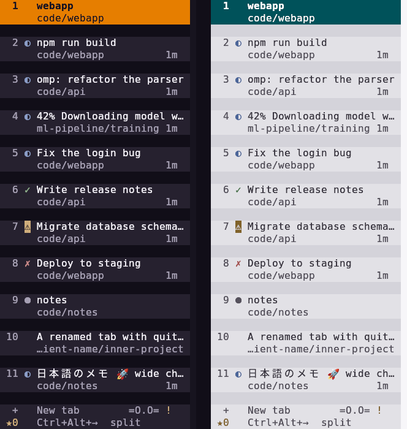
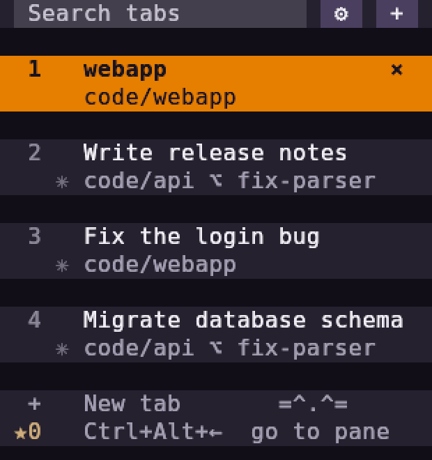

# NineLives

A kitty terminal setup for Linux (built on Pop!_OS COSMIC, Wayland), for watching many AI coding sessions at
once. Every session is a tab in a left sidebar with a live status icon; a quiet sound and a small cat
tell you when a tab finishes or needs you; tabs drag to reorder; and one script restarts kitty and
brings every tab back. Nine lives, one cat.





```
  1   proj-one                     the tab you're on (accent colour)
      alpha/proj-one
  2 ◐ sleep 600                    working (spins)
      work/beta              3m    …for 3 minutes
  7 ▮ Migrate database schema…     needs you (filled amber block): act on this one
      work/beta              1m
  +   New tab           =O.O= !    the cat: a tab needs you
 ★4   Ctrl+Alt+Z  zoom pane        your next quest
```

## Start here
- [Getting started](Getting-Started): install, first restart, and a walkthrough in pictures
- [What's new](Whats-New): recent changes
- [Installing](Installing): install, update, restart without losing tabs
- [The sidebar](The-Sidebar): what every icon, colour and number means
- [Sounds](Sounds): what each sound means, volume, muting
- [The cat](The-Cat): the face at the end of **+ New tab**
- [Quests and badges](Quests-and-Badges): learn kitty shortcuts by using them
- [Shortcuts](Shortcuts): every key and mouse action (or press **F1** in kitty)
- [Commands and switches](Commands-and-Switches): `kitty-sounds`, `kitty-cat`, `kitty-quests`, `kitty-tips`, and the files behind them
- [Troubleshooting](Troubleshooting)
- For changing the code: [How it works](How-It-Works) and [Testing](Testing)

## Principles
1. **Status first.** What a tab is doing reads at a glance, by icon and colour, before any text.
2. **Readable.** Text at least 4.5:1 contrast and icons at least 3:1, in both themes.
3. **Fun that teaches.** Animations, sounds and badges point at something worth learning.
4. **Never in the way.** Sounds are quiet, nothing pops up while an agent works, and everything can be turned off.
5. **Survives kitty updates.** Patches check what they rely on and switch themselves off instead of breaking.

Code, issues and releases: [github.com/Vyeche/NineLives](https://github.com/Vyeche/NineLives).
These pages live in the repository under `docs/wiki/`; edit them there and publish with
`bash scripts/publish-wiki.sh`.
