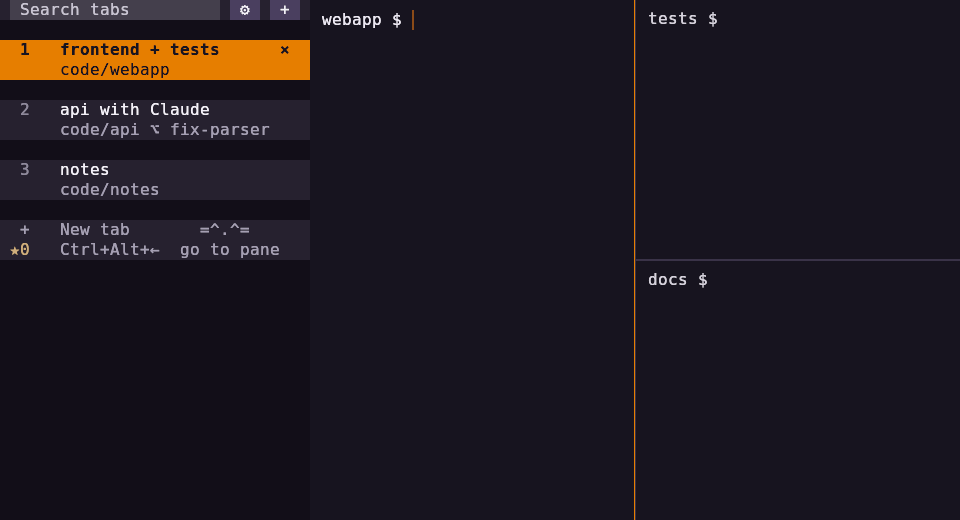

# Installing

Needs Linux, **kitty 0.50 or newer** (the [official build](https://sw.kovidgoyal.net/kitty/binary/);
Ubuntu's apt kitty 0.32 has no sidebar and no tab dragging) and Python 3. Sounds need `paplay`
(PipeWire or PulseAudio; installed on most desktops); without it NineLives is just silent.

## Install or update
```bash
git clone https://github.com/Vyeche/NineLives.git && cd NineLives   # once
bash scripts/install.sh --dry-run   # see what would change; touches nothing
bash scripts/install.sh             # copy config/ (and config/sounds/) into ~/.config/kitty
```
After the first install, **close kitty and open it again once**: the sidebar's patches and the
remote-control socket (below) only load when kitty starts. To update later: `git pull`, then
`bash scripts/install.sh` again.
- A file it would overwrite is saved first as `<file>.bak-<date-time>`. Files that are already the same are skipped.
- Of each file's backups, the newest 3 and the very oldest (most likely your config from before
  NineLives) are kept, so updating often doesn't pile them up. Other
  people's files and backups (any other name) are never touched. Keep more or all of them with
  `NL_KEEP_BACKUPS=10` or `NL_KEEP_BACKUPS=all`; `--dry-run` lists what would be removed.
- It warns if kitty is older than 0.50, then checks the result with kitty's own config parser (`Config check: OK`).
- Another folder: `KITTY_CONFIG_DIRECTORY=/path bash scripts/install.sh`.
- It never touches your quest progress (`~/.local/state/ninelives/`) or your on/off switches (see [Commands and switches](Commands-and-Switches)).

## Making changes take effect
| You changed | Do this |
| --- | --- |
| `kitty.conf`, colours | press **Ctrl+Shift+F5** in kitty |
| `tab_bar.py` | restart kitty (below). A reload runs the new file, but the patches it puts into kitty keep their old version until a restart. `ninelives` tells you when kitty is still running an older one |
| `tips.sh`, `shortcuts.sh` | open a new tab |
| sounds | nothing: the next sound plays the new file |

## Restart kitty and keep every tab
```bash
bash scripts/kitty-relaunch.sh --dry-run     # list what would reopen
bash scripts/kitty-relaunch.sh --status      # which tabs --when-idle would wait for, and why
bash scripts/kitty-relaunch.sh --when-idle   # wait until every tab is idle (~30 s quiet), then restart
bash scripts/kitty-relaunch.sh               # restart now
```


A tab counts as busy while Claude (or another agent) is working **or waiting for you** (a restart would
drop its question), while omp/opencode show a spinner, or while a plain shell runs a command (a build, a
test run). Editors, pagers and `top` that just sit open don't count.

**Which kitty:** the one you run it in. NineLives' `kitty.conf` gives every kitty a remote-control
socket of its own (`listen_on unix:${XDG_RUNTIME_DIR}/ninelives-kitty-{kitty_pid}`, with
`allow_remote_control socket-only`): in your private runtime folder, so only you can use it, and
only through the socket, not from programs writing to the terminal. A kitty started with
`--listen-on` (by a launcher, say) keeps that socket instead, since kitty's command line wins over
`kitty.conf`, and the restart finds it too. Run from outside kitty, the script restarts the only
kitty with a socket, or lists them when there are several so you can run it from a tab of the right
one. A kitty started before you installed NineLives has no socket until it is opened again.

Each tab comes back in its folder, and so does every pane of a split tab (each in its own folder):
- **Claude** with `claude --resume <session>`. A Claude pane started without a session id comes back with `claude --continue` (the newest session in that folder). Several such panes in one folder (in any tabs) can't be told apart, so they come back as shells with a hint to `claude --resume`.
- A folder that no longer exists becomes your home folder (a Claude pane without a session id then gets the `claude --resume` hint, since `--continue` would pick home's newest session).
- **omp** with `--continue`.
- **Anything else** as a shell.

**Splits** come back as they were: the same layout, the same split sizes, and the pane you were in.
A zoomed tab (Ctrl+Alt+Z) comes back zoomed, and Ctrl+Alt+Z still returns to its splits. Names you
gave tabs (Ctrl+Shift+R) come back too, and kitty lands on the tab you were on. Tabs from several kitty
windows come back as tabs of one window. Under the hood the new kitty opens a kitty session file
(`~/.cache/ninelives/kitty-relaunch.kitty-session`) written like kitty's own
`save_as_session` output, and kitty's own parser checks it before the old kitty is closed (if it can't
read it, the restart stops and kitty keeps running); `--dry-run` lists every pane. The new kitty
listens on the old one's socket. The script runs detached, so it finishes even when started from
inside that window. Log: `~/.cache/ninelives/kitty-relaunch.log` (`$XDG_CACHE_HOME/ninelives` if you
set that).

## Prompt tips
The tip (or next quest) under each new prompt needs this line in `~/.bashrc`:
```bash
if [[ $- == *i* && "$TERM" == xterm-kitty && -r ~/.config/kitty/tips.sh ]]; then . ~/.config/kitty/tips.sh; fi
```
It also defines `kitty-tips`, `kitty-quests`, `kitty-sounds` and `kitty-cat` in your shell.

## Light and dark
kitty switches between `light-theme.auto.conf` and `dark-theme.auto.conf` by itself when your desktop
reports a light/dark preference through the desktop portal (COSMIC does; it is the standard
freedesktop setting, so other desktops that publish it work too). Where nothing
reports one, kitty uses `no-preference-theme.auto.conf`, which is the dark theme. `cosmic-dark.conf`
and `cosmic-light.conf` hold the same colours: COSMIC backgrounds and accent (orange on dark, teal on
light) and a soft, "dusty" set of the 16 terminal colours.

Always light, whatever the desktop says: copy the light file over the other two
(`cd ~/.config/kitty && cp light-theme.auto.conf dark-theme.auto.conf && cp light-theme.auto.conf no-preference-theme.auto.conf`).
`install.sh` puts NineLives' versions back on the next update (keeping yours as backups), so redo it then.

## Uninstall
```bash
bash scripts/uninstall.sh --dry-run   # see what would change; touches nothing
bash scripts/uninstall.sh
```
- It only looks at the files `install.sh` installs and their `.bak-<date-time>` backups.
- A file that is a NineLives version (this repo's, or any version in its git history) is removed; a file you changed is kept and listed.
- Backups that are NineLives versions are removed, and the oldest other backup of each file (your own, from before NineLives) is put back.
- Your switches, quest progress (`~/.local/state/ninelives/`), the restart's cache (`~/.cache/ninelives/`) and the `tips.sh` line in `~/.bashrc` stay; it tells you where they are.
- Restart kitty afterwards.
