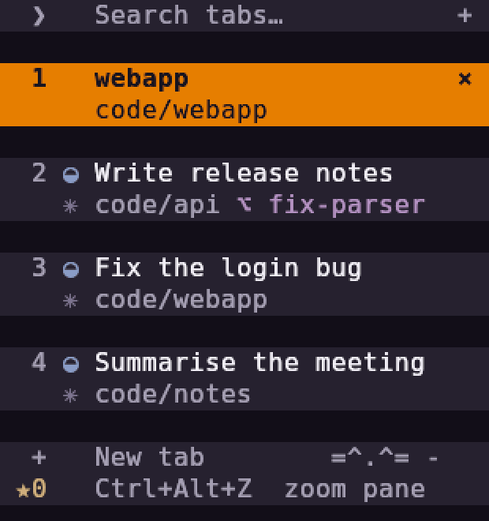

# Sounds

NineLives has its own small set of sounds. They are **quiet on purpose**: about 7 dB under the desktop's
own "complete" chime. Each has its own shape, so you can tell them apart without looking:

| Sound | Shape | When |
| --- | --- | --- |
| **done** | two soft notes going up | a tab finished (a plain shell command only if it ran 15 s or more). Another tab finishing within 90 s plays it a step higher, and a third higher again, so a run of finishes climbs a little tune |
| **needs you** | a rising "mrrp?" | a tab is waiting for you. The one you must not miss, so a little louder than the rest |
| **error** | two low notes going down | something failed |
| **badge** | a quick bell run up | you earned a badge |
| **rank** | a short run up to a chord | you reached a new rank |
| **drop** | one tiny wooden tick | a dragged tab landed (barely there) |



## When sounds don't play
- **You're looking at it.** If the tab that finishes or fails is the one on screen in the kitty window you're using, there's no sound. "Needs you" still plays.
- **Bursts play once.** Sounds within about a second of each other play only the most important one (rank, badge, needs you, error, done, drop).
- **Muted.** **Ctrl+Alt+M** mutes and unmutes (it plays the done sound when sound comes back on).

## A reminder for a waiting tab
If a tab has been waiting for you for **3 minutes** and you haven't looked at it, it plays "needs you" once
more, softer, and its amber block blinks again. Only once per wait.

## Commands
```bash
kitty-sounds               # play each sound with its meaning
kitty-sounds volume 40     # 5–100 % (default 100); kitty-sounds volume shows the current one
kitty-sounds classic       # use the desktop's standard sounds instead
kitty-sounds ninelives     # back to these
kitty-sounds off / on      # same as Ctrl+Alt+M
```
In classic mode "needs you" and "error" are one sound on Pop!_OS (both files link to `dialog-warning.oga`),
which is one reason NineLives has its own.

## Changing a sound
The sounds are made from scratch by `scripts/make-sounds.py` (plain Python synthesis, ffmpeg for `.oga`).
Edit a sound's notes or its level in `PEAK_DB`, then:
```bash
python3 scripts/make-sounds.py      # rewrites config/sounds/*.oga (same input gives the same files)
bash scripts/install.sh
kitty-sounds                        # listen
```
Check loudness (LUFS) with:
```bash
ffmpeg -i config/sounds/done.oga -af "apad=pad_dur=2,ebur128" -f null - 2>&1 | grep -A2 Summary
```
Targets: done, error and badge about −25 LUFS, rank −24, needs you −22, drop −35.
