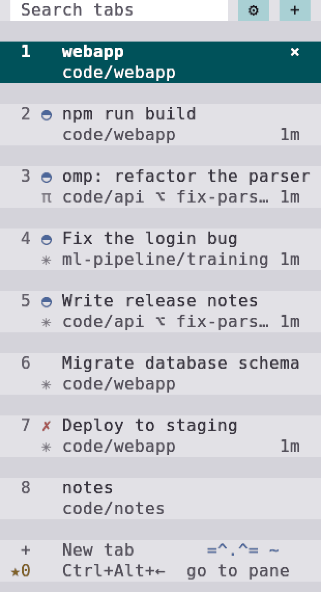
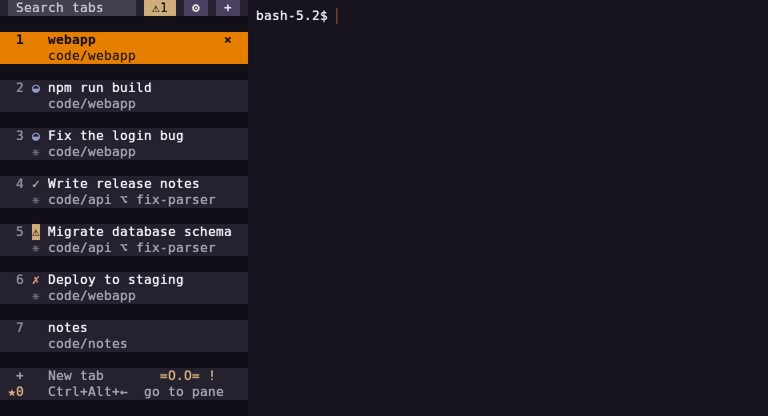

# The sidebar

Every tab is two lines, with names and folders lined up in one column:
```
 12 ◐ Fix the login bug          number, status, name (long names end in …)
    ✳ alpha/proj-one      3m     agent, last two folders, how long it has been in this state
```
Each tab has one strong signal: its status icon (and its name). Everything else is quiet: the
number, the agent mark, the folder, the branch and the time are in the tab's own muted colour, the
number and the mark a shade quieter still (kept just above 4.5:1 for text and 3:1 for marks in both
themes), so a ⚠ or a ✓ stands out at a glance.
- **Name:** the tab's title (Claude's task, omp's title), or the folder name for a plain shell (also one whose title is just `bash`, as for a shell without kitty's shell integration, unless you named the tab that). Claude's `✳` prefix is dropped: the status slot already says that. Rename with **Ctrl+Shift+R**. A running command's tab shows only its program and subcommand (`git push`, not `git push origin main`): see [below](#commands-in-tab-names).
- **Number:** what **Alt+1…9** goes to (and what the search box finds by number), in a quiet grey.
- **Agent:** under the status icon, a small quiet mark says which agent runs in the tab: `✳` Claude, `π` omp, two letters for others (`oc` opencode, `cx` codex, `gm` gemini, `ai` aider). A plain shell has none.
- **Folder:** the last two folders, with `~` for home; cut at the start with `…` if long. In a git repo on a branch other than `main`/`master`, the branch follows in the folder's colour: `code/api ⌥ fix-parser` (a branch only fits whole or with at least a few letters; otherwise it is left out).
- **Time** (`3m`, `1h05`): how long the tab has been working, waiting or finished. It appears after one minute, and counts from when the sidebar first saw that state, so it starts again after a kitty restart.

## Commands in tab names
While a command runs, kitty's shell integration names the tab after the whole command line, and a
command line can hold a password or a token (`mysql -p…`, `curl -H "Authorization: …"`,
`export TOKEN=…`). So the sidebar, the search box (Ctrl+Shift+Space) and `kitty-relaunch.sh --status`
show only the program and its subcommand:

| Command line | Tab name |
| --- | --- |
| `git push origin main` | `git push` |
| `cd app && npm run build -- --token=…` | `npm run build` (a chain: its last command) |
| `cat log \| grep error` | `cat` (a pipe: its first command) |
| `API_KEY=… docker compose up -d` | `docker compose up` (`VAR=value` is never shown) |
| `sudo -u db psql -c "…"` | `psql` (sudo, env, time, timeout, … are skipped) |
| `python3 -m pytest -k …` / `python3 scripts/check.py …` | `python3 -m pytest` / `python3 check.py` |
| `node -e "…"`, `bash -c "…"` | `node`, `bash` (code is never shown) |
| `mysql -u root -p…`, `ssh me@host`, `echo …` | `mysql`, `ssh`, `echo` |

The word after the program is shown only for programs whose next word is a subcommand, or a target,
task or script name a project defines (git, npm, docker, make, cargo, kubectl, …; not pytest, code or
cmake, whose next word is a path), and only if it looks like one (lowercase letters, digits, `-`, `_`);
after `run` (npm, uv, poetry, …) and `compose` (docker, podman) one more (`docker run` stops there: an
image name follows). The one argument shown is a script's file name after an interpreter
(`python3 check.py`): it is what tells those tabs apart. Quoted text is never read as a `;`, `&&` or `|`,
and a word that isn't a program's name (a quoted string with spaces, a `$VAR`) never shows as one:
`watch 'kubectl get pods'` is named `kubectl get`, `timeout 5 '…'` just `timeout`. Searching finds tabs
by that short name, never by an argument.

Names programs set themselves stay as they are (Claude's `✳ Fix the login bug`, omp's spinner and task),
so do names you give a tab (Ctrl+Shift+R) or a window, and an idle shell's folder. NineLives tells them
apart by comparing the title with the command line the shell reported to kitty when the command
started (`config/command_title.py` has the details). The search box and the sidebar use the same rule.

To see whole command lines again: `kitty-commands full`, or **Full commands in tab names** in the
settings list (Ctrl+Shift+F2); `kitty-commands short` goes back. It applies at once.

The limits: NineLives doesn't change kitty's own titles or messages. kitty's OS-window title (the
taskbar, Alt+Tab, the window's title bar) still shows the whole command line of the active tab while
it runs, and so does kitty's desktop notification when a command of 15 s or more finishes in a tab
you aren't looking at (`notify_on_cmd_finish` in `kitty.conf`). A secret typed as the command itself
(pasted at the prompt by mistake) is the program's name and shows. A remote shell that sets the title
to the command without reporting it to kitty (no kitty shell integration there) shows it whole.

## Search field and buttons
The top of the sidebar has a search field and a few buttons, like Warp's:
```
 [ Search tabs      ] [⚠1] [⚙] [+]
```
The field is filled with the terminal's own background (white on the light theme), the buttons are
filled chips in the theme's selection colour, so the row reads as something to click.
- **Search tabs**: click the field to search your tabs (the same box as **Ctrl+Shift+Space**).
- **⚠1**: appears only while tabs are waiting for you (an amber chip, with how many); click it to go to the
  next one (same as **Ctrl+Alt+U**). With nothing waiting the row is the field, **⚙** and **+**.
- **⚙**: the [NineLives settings](Commands-and-Switches#the-settings-list) (same as **Ctrl+Shift+F2**).
- **+**: a new tab in the current folder.
- **×** at the right end of the tab you're on closes it (it asks first if something is running).

A button lights up in the accent colour while you hold it down. There is no hover look: kitty 0.51
sends the tab bar no mouse moves (only while a tab is dragged or text in it is selected) and has no
way to ask where the pointer is, so nothing can change as the mouse passes over (kitty does show a
hand pointer there). For the same reason only the current tab has a ×.


In a narrow window or with a big font kitty makes the sidebar narrower (it never takes more than a
third of the window), and the row makes room for its buttons: the field's words get shorter
(`Search`, `Find`, then none), then the chips get narrower, while `⚠1`, `⚙` and `+` stay whole and
clickable, `+` always above the `×` and in line with the times. Words are never cut in half: **+ New
tab** shortens to `+ New` and `+`, and the quest line under it drops its words before its key
(`Ctrl+Shift+H  history`, then `Ctrl+Shift+H`, then just `★8`). Long tab names and folders end in `…`.

Clicking a button doesn't earn that shortcut's quest badge: the quests teach the keys.
`kitty-buttons off` hides the row and the ×, `kitty-buttons on` brings them back.

## Status


The same in the light theme:



| Icon | Colour | Means |
| --- | --- | --- |
| ◐◓◑◒ spinning | blue | working: Claude or another agent is busy, a progress report is running, or a command runs in a plain shell tab |
| `42%` before the name | | a progress report with a percentage |
| `· ✧ ✦ ✶` then ✓ | gold, then green | just finished: a short burst that lands on ✓. ✓ stays until you look at the tab |
| ⚠ on a **filled amber block** | amber | **needs you**: a permission prompt or a question. It blinks for 6 s, then stays filled. The strongest mark in the sidebar |
| ✗ | red | something failed |
| ‖ | | paused |
| • | quiet grey | new output in a tab you're not looking at (small on purpose: it's news, not a call) |

NineLives doesn't ask the desktop for attention when a tab needs you: on COSMIC that brings kitty to
the front and takes the keyboard, even mid-sentence in another app. The sound and the cat tell you instead.

Status is never colour alone: every state has its own glyph. The tab you're on stays one colour on the
accent background.

Where status comes from: Claude Code reports it to kitty directly. omp and opencode show a spinner in
their title, which counts as working. For a plain shell tab, "working" means a command is in the
foreground (not full-screen programs like vim, htop or less, and not an idle agent).

## More tabs than fit
In a short window kitty first drops the blank lines between tabs. If the tabs still don't fit, the
sidebar keeps the ones that matter: **+ New tab** with the cat, the tab you're on, every tab waiting
for you, tabs with an error, then the tabs nearest yours. The last line names the rest, e.g.
`⋯ hidden: 1–2, 10`; click that line to go to the first hidden tab. Tabs keep their real numbers, so
**Alt+N** still goes to tab N.
Which tabs are shown is written to `~/.local/state/ninelives/sidebar.txt` whenever it changes, with
their agent marks (`agents: 3:π 12:✳`), which kitty wrote it (`kitty:` and its process id), the current tab's folder line as kitty drew it (`drawn folder:
✳ code/api ⌥ fix-parser`) and its name line (`drawn name:`, left out while `kitty-commands full` is on, so a
whole command line is never written down), where the buttons are and the columns kitty really drew `⚠`, `⚙`, `+` and `×`
in (`check.sh` compares them).

## Celebrations
When you earn a badge, a gold wave runs down the tab numbers, and the line under **+ New tab** sparkles
with the badge name for 8 seconds. See [Quests and badges](Quests-and-Badges).

## Mouse and keys
| Do | How |
| --- | --- |
| switch | click a tab, **Alt+1…9**, **Ctrl+PgUp/PgDn** |
| find a tab | **Ctrl+Shift+Space**: type part of its name, folder or number, Enter goes there |
| the tab waiting for you | **Ctrl+Alt+U** (again: the next one; a failed tab when none is waiting) |
| new tab here | **Ctrl+Shift+T** or click **+ New tab** |
| reorder | drag a tab (an orange line shows where it lands; let go outside the sidebar to cancel), or **Ctrl+Shift+←/→** |
| close | middle-click, or **Ctrl+Shift+W** (asks if something is running) |
| rename | **Ctrl+Shift+R** |

Click anywhere on a tab's two lines or the gap below them; the whole block belongs to the tab.



### Dragging on COSMIC
kitty 0.50 hands a dragged tab to the compositor, which COSMIC ignores, so kitty's own drag does nothing
there. NineLives keeps the drag inside the sidebar instead, using kitty's own drop line and re-ordering.
Limits: no card under the mouse, and a tab can't be dragged into another kitty window. A tiny tick sound
plays when a tab lands. With `linux_display_server x11`, kitty's own drag works and shows the NineLives
drag card (a high-contrast card that follows the theme).
