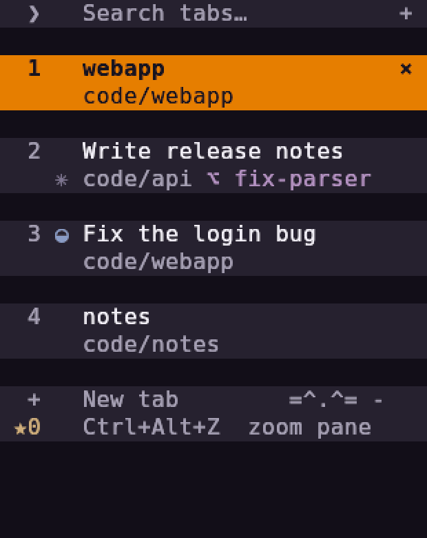

# The sidebar

Every tab is two lines, with names and folders lined up in one column:
```
 12 ◐ Fix the login bug          number, status, name (long names end in …)
      alpha/proj-one      3m     last two folders, and how long it has been in this state
```
- **Name:** the tab's title (Claude's task, omp's title), or the folder name for a plain shell (also one whose title is just `bash`, as after a restart, unless you named the tab that). Claude's `✳` prefix is dropped: the status slot already says that. Rename with **Ctrl+Shift+R**.
- **Agent:** under the status icon, a small grey mark says which agent runs in the tab: `✳` Claude, `π` omp, two letters for others (`oc` opencode, `cx` codex, `gm` gemini, `ai` aider). A plain shell has none.
- **Folder:** the last two folders, with `~` for home; cut at the start with `…` if long. In a git repo on a branch other than `main`/`master`, the branch follows in magenta: `code/api ⌥ fix-parser`.
- **Time** (`3m`, `1h05`): how long the tab has been working, waiting or finished. It appears after one minute, and counts from when the sidebar first saw that state, so it starts again after a kitty restart.

## Search row and buttons
The top of the sidebar has a search row, like Warp's:
```
  ❯   Search tabs…     ⚠1  +
```
- **Search tabs…**: click to search your tabs (the same box as **Ctrl+Shift+Space**).
- **⚠1**: appears only while tabs are waiting for you (amber, with how many); click it to go to the
  next one (same as **Ctrl+Alt+U**). With nothing waiting the row is just the search and **+**.
- **+**: a new tab in the current folder.
- **×** at the right end of the tab you're on closes it (it asks first if something is running).
  kitty can't tell where the mouse hovers, so only the current tab has one.



In a narrow window or with a big font kitty makes the sidebar narrower (it never takes more than a
third of the window), and the row makes room for its buttons: the words get shorter (`Search…`,
`Find…`, then only `❯`) while `⚠1` and `+` stay whole and clickable, `+` always above the `×`.
**+ New tab**, the quest line and the tabs' names and folders fit the narrower sidebar too.

Clicking a button doesn't earn that shortcut's quest badge: the quests teach the keys.
`kitty-buttons off` hides the row and the ×, `kitty-buttons on` brings them back.

## Status


The same in the light theme:


| Icon | Colour | Means |
| --- | --- | --- |
| ◐◓◑◒ spinning | blue | working: Claude or another agent is busy, a progress report is running, or a command runs in a plain shell tab |
| `42%` before the name | | a progress report with a percentage |
| `· ✧ ✦ ✶` then ✓ | gold, then green | just finished: a short burst that lands on ✓. ✓ stays until you look at the tab |
| ⚠ on a **filled amber block** | amber | **needs you**: a permission prompt or a question. It blinks for 6 s, then stays filled. The strongest mark in the sidebar |
| ✗ | red | something failed |
| ‖ | | paused |
| ● | | new output in a tab you're not looking at |

NineLives doesn't ask the desktop for attention when a tab needs you: on COSMIC that brings kitty to
the front and takes the keyboard, even mid-sentence in another app. The sound and the cat tell you instead.

Status is never colour alone: every state has its own glyph. The tab you're on stays one colour on the
accent background.

Where status comes from: Claude Code reports it to kitty directly. omp and opencode show a spinner in
their title, which counts as working. For a plain shell tab, "working" means a command is in the
foreground (not full-screen programs like vim, htop or less, and not an idle agent).

## More tabs than fit
In a short window kitty first drops the blank lines between tabs. If the tabs still don't fit, the
sidebar keeps the ones that matter: **+ New tab** with the cat, the tab you're on, every tab waiting
for you, tabs with an error, then the tabs nearest yours. The last line names the rest, e.g.
`⋯ hidden: 1–2, 10`; click that line to go to the first hidden tab. Tabs keep their real numbers, so
**Alt+N** still goes to tab N.
Which tabs are shown is written to `~/.local/state/ninelives/sidebar.txt` whenever it changes, with
where the buttons are and the columns kitty really drew `⚠`, `+` and `×` in (`check.sh` compares them).

## Celebrations
When you earn a badge, a gold wave runs down the tab numbers, and the line under **+ New tab** sparkles
with the badge name for 8 seconds. See [Quests and badges](Quests-and-Badges).

## Mouse and keys
| Do | How |
| --- | --- |
| switch | click a tab, **Alt+1…9**, **Ctrl+PgUp/PgDn** |
| find a tab | **Ctrl+Shift+Space**: type part of its name, folder or number, Enter goes there |
| the tab waiting for you | **Ctrl+Alt+U** (again: the next one; a failed tab when none is waiting) |
| new tab here | **Ctrl+Shift+T** or click **+ New tab** |
| reorder | drag a tab (an orange line shows where it lands; let go outside the sidebar to cancel), or **Ctrl+Shift+←/→** |
| close | middle-click, or **Ctrl+Shift+W** (asks if something is running) |
| rename | **Ctrl+Shift+R** |

Click anywhere on a tab's two lines or the gap below them; the whole block belongs to the tab.


### Dragging on COSMIC
kitty 0.50 hands a dragged tab to the compositor, which COSMIC ignores, so kitty's own drag does nothing
there. NineLives keeps the drag inside the sidebar instead, using kitty's own drop line and re-ordering.
Limits: no card under the mouse, and a tab can't be dragged into another kitty window. A tiny tick sound
plays when a tab lands. With `linux_display_server x11`, kitty's own drag works and shows the NineLives
drag card (a high-contrast card that follows the theme).
